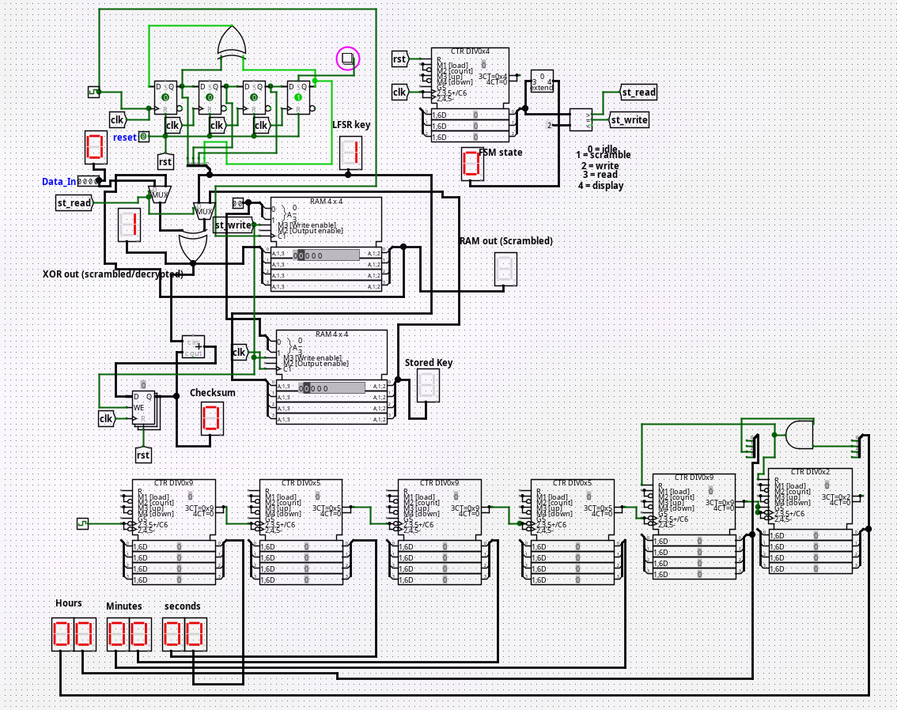

# lfsr-data-logger
A 4-bit input is scrambled with a pseudo-random key from an LFSR, stored in RAM, and read back (unscrambled) using the key saved at write time. A digital clock

## How it works
 
**Scrambler datapath**
- The 4-bit data goes through a 2-to-1 MUX into a 4-bit XOR with the LFSR key.
- The result is written to a 4x4 RAM (2-bit address, 4-bit data).
- A second 4x4 RAM stores the key used for each write, at the same address.
- On read, the MUXes switch to the RAM output and the stored key. XOR with the stored key restores the original data.
- Four D flip-flops in a shift register. Feedback is Q1 XOR Q4 into the first flip-flop.
-  if it has 0000 hit the button near the d flops
**Checksum**
- A 4-bit adder and a 4-bit register keep a running sum of the scrambled data. It updates only during a write.
**FSM controller**
- A 3-bit counter (0 to 4) steps through IDLE, SCRAMBLE, WRITE, READ, DISPLAY.
- A comparator decodes it into two control signals:
  - `st_write` (state 2) enables the RAMs and the checksum register.
  - `st_read` (states 3 and 4) switches the MUXes to read mode.
**Digital clock**
- Six counters: seconds (9, 5), minutes (9, 5), hours (9, 2).
- Falling-edge triggered, each carry output clocks the next digit.
- An AND gate (hours tens = 2, hours ones = 4) clears the hour counters, so it rolls over 23:59:59 to 00:00:00.

:: added fsm to automate every function happening 
  
## How to run
 
1. Open `final.circ` in Logisim Evolution.
2. Pulse `reset` (1, then back to 0).
3. Click the seed button once to start the LFSR.
4. Set `Data_In` (4 bits) and the RAM address.
5. Enable ticks (Simulate > Ticks Enabled, or Ctrl+K), or step with Ctrl+T.
Each pass through the FSM scrambles and writes the data in state 2, then shows the recovered data in states 3 and 4.

##circuit :

